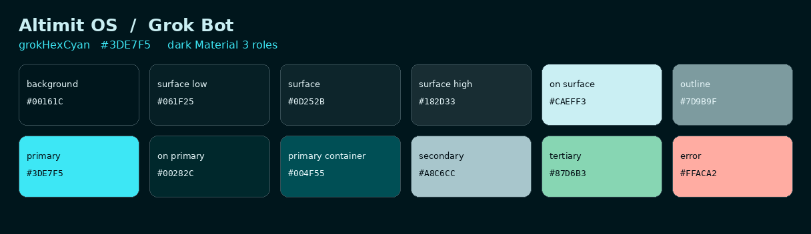
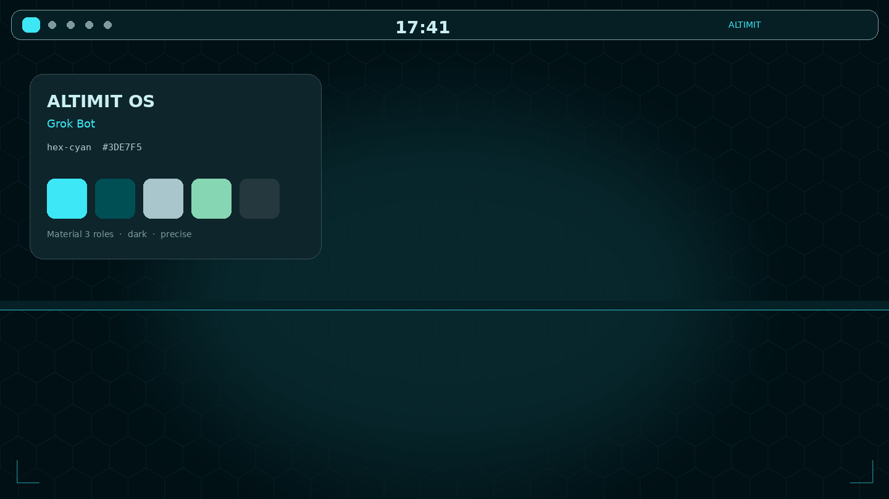

<div align="center">

# end4-pC

**Altimit OS / Grok Bot** theme for [illogical-impulse](https://github.com/end-4/dots-hyprland) Quickshell

Dark, precise Material 3 chrome with a hex-cyan accent (`#3DE7F5`, `grokHexCyan`).

</div>

---

## Theme

The shell loads this palette by default. Tokens live in [`defaults/theme/altimit-os-grok-bot.json`](defaults/theme/altimit-os-grok-bot.json) (`id`: `altimit-os-grok-bot`). The same values are the fallback colors in `modules/common/Appearance.qml`, so the first frame matches the file.

`appearance.palette.lockTheme` defaults to `true`, which keeps the bar, sidebars, and widgets on this palette instead of recoloring them from the wallpaper.

<p align="center">
  
</p>

<p align="center">
  
</p>

### Palette

| Role | Hex | Use |
|---|---|---|
| background / surface | `#00161C` | Shell and panel base |
| surface container | `#0D252B` | Cards, raised chrome |
| on surface | `#CAEFF3` | Primary text |
| **primary (`grokHexCyan`)** | **`#3DE7F5`** | Accent, active indicators, focus |
| on primary | `#00282C` | Text on the accent |
| primary container | `#004F55` | Filled buttons and chips |
| secondary | `#A8C6CC` | Quiet chrome |
| tertiary | `#87D6B3` | Mint status, not purple |
| outline | `#7D9B9F` | Floating bar and panel edges |

Roles match the Material 3 set the expressive shell already reads (`primary`, `surfaceContainer`, `outline`, and the rest). Generation stays on **scheme-tonal-spot** with accent `#3DE7F5`. Material's `scheme-expressive` from this seed pushes secondary and tertiary toward purple, so that variant is not the default.

The default wallpaper is `assets/images/default_wallpaper.png` (dark field, faint hex grid, cyan horizon). The bar defaults to the floating style so the outline reads as a thin edge.

### Let wallpaper colors through

In `~/.config/illogical-impulse/config.json`:

```json
"palette": {
  "type": "scheme-tonal-spot",
  "accentColor": "#3DE7F5",
  "theme": "altimit-os-grok-bot",
  "lockTheme": false
}
```

Then pick a wallpaper, or run the shell's wallpaper switch. Set `accentColor` to `""` if extraction should come from the image instead of the cyan seed. While `lockTheme` is true, the dark/light toggle still runs the color scripts for other apps, and the shell itself stays on this palette.

---

## Apply

This config uses its own Quickshell folder. It does not replace an existing illogical-impulse install. [illogical-impulse](https://github.com/end-4/dots-hyprland) needs to be installed and running (Hyprland, Quickshell, and the usual `qs` dependencies).

```bash
cd ~/.config/quickshell/
git clone https://github.com/shinarugrok-a11y/end4-pC.git
killall qs 2>/dev/null; qs -c end4-pC > /dev/null 2>&1 & disown
```

`qs -c end4-pC` is the config name Quickshell loads. Reload the shell after pulling theme changes.

### Use it as the Hyprland shell (optional)

Edit `~/.config/hypr/hyprland/variables.lua` and change:

```lua
hl.env("qsConfig", "ii")
```

to:

```lua
hl.env("qsConfig", "end4-pC")
```

Restart Hyprland, or run `hyprctl reload`.

### Settings keybind

Settings is an overlay. Add this to your Hyprland config:

```lua
hl.bind("SUPER + escape", hl.dsp.global("quickshell:settingsToggle"), {description = "Toggle settings"})
```

Toggle it with the same key, or press `Escape`. `Super + Q` does not close it.

---

## Credits

- **[@end-4](https://github.com/end-4)** — [dots-hyprland](https://github.com/end-4/dots-hyprland) / illogical-impulse, which this config forks
- **[@pctrade](https://github.com/pctrade)** — the end4-pC fork this theme is built on
- **[@gh0stzk](https://github.com/gh0stzk)** — weather API used by the weather widget
- **[@StarS2112](https://github.com/StarS2112)** — showcase of the fork
